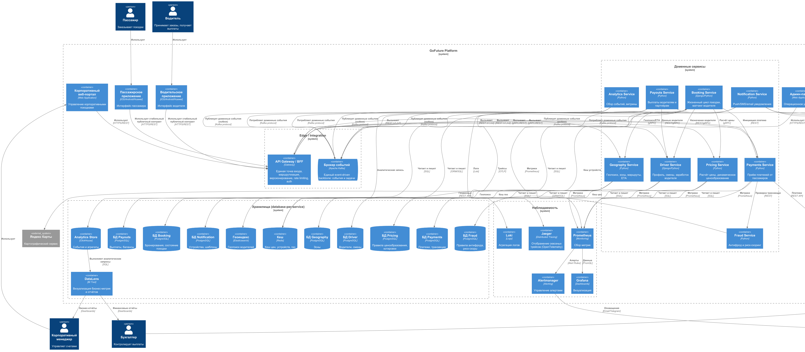

# ADR-002: Карта доменных сервисов

- **Автор:** Дмитрий Ренев
- **Статус:** На согласовании
- **Согласующие:** Дмитрий Бардин
- **Дата:** 2026-10-12
- **Связанные артефакты:** [c2-to-be.puml](../diagrams/c2-to-be.puml), [ADR-001-nfr.md](../adr/ADR-001-nfr.md), [ADR-003-extraction-order.md](../adr/ADR-003-extraction-order.md)

---

## Контекст

As-Is: единая Django-кодовая база, все домены работают с **одной БД PostgreSQL**, домены связаны прямыми синхронными вызовами 
(booking → driver/pricing/payments/geography/fraud/notification) и прямыми SQL к общим таблицам. 
Такая связность делает невозможным независимое масштабирование (NFR-SC-02) и изоляцию сбоев (NFR-A-02), 
а релиз любого домена требует релиза всего монолита (NFR-M-01).

Организационно уже существуют **8 продуктовых команд** по доменам – Booking, Driver, Pricing, Payments, Notification, Geography, 
Analytics, Fraud, плюс платформенная, SRE, data и инфраструктурная команды. Целевые сервисы должны совпадать с границами 
ответственности команд (закон Конвея).

Домен **Payouts** (выплаты водителям) выделен отдельно от **Payments** (платежи от пассажиров) – это разные bounded context 
с разными регуляторными и финансовыми рисками, поэтому граница сохраняется.

## Требования

1. Определить целевые доменные сервисы с чёткими границами (bounded context) и владением данными.
2. Зафиксировать стиль интеграции между сервисами (sync/async) и владение хранилищами (database-per-service).
3. Обеспечить прослеживаемость: целевой сервис ↔ продуктовая команда ↔ текущий компонент монолита.
4. Оставить место для платформенных механизмов (шлюз, брокер сообщений), детализируемых в дальнейших ADR, не углубляясь в них здесь.

## Решение

### Карта сервисов (To-Be)

| Сервис | Домен (bounded context) | Продуктовая команда | Владеет данными | Стиль интеграции | Ключевые потребители |
|--------|-------------------------|-------------------|-----------------|------------------|----------------------|
| **Booking Service** | Жизненный цикл поездки (заказ, матчинг, статусы) | Booking | bookings, trip_state | Sync (REST) + async (события) | Приложения, Portal, Driver, Payments |
| **Driver Service** | Профиль, статус, смены, заработок водителя | Driver | drivers, shifts | Sync (REST) | Booking, Geography, Payouts |
| **Pricing Service** | Расчёт и правила цены, surge | Pricing | pricing_rules, quotes | Sync (REST/gRPC, низкая задержка) | Booking, Driver |
| **Payments Service** | Приём платежей от пассажиров | Payments | payments, transactions | Sync (REST) + async | Booking, Fraud, внешний платёжный шлюз |
| **Payouts Service** | Выплаты водителям и партнёрам | Payments | payouts, balances | Async (события) + sync | Driver, внешние банковские API |
| **Notification Service** | Доставка push/SMS/email | Notification | devices, templates | Async (события) | Все сервисы (через события) |
| **Geography Service** | Геопоиск, зоны, маршруты, ETA | Geography | zones, geo_index | Sync (REST/gRPC, низкая задержка) | Booking, Driver, Pricing |
| **Analytics Service** | Сбор событий, витрины | Analytics | events, aggregates | Async (события, поток) | Data/ML, BI, Fraud, Pricing |
| **Fraud Service** | Антифрод, риск-скоринг | Fraud | fraud_rules, risk_scores | Sync (проверка) | Payments, Booking |

### Принципы границ

1. **Database-per-service.** Каждый сервис владеет своей схемой/БД; прямые SQL-доступы к чужим таблицам запрещены. Обмен – только через API или события.
2. **Единый владелец данных.** Таблица принадлежит ровно одному сервису (устраняем As-Is практику, где несколько доменов пишут в общие таблицы).
3. **По стилю интеграции:**
   - **Sync (REST/gRPC)** – там, где нужен немедленный ответ в рамках пользовательского запроса (matching, цена, геопоиск).
   - **Async (события через брокер)** – для уведомлений, аналитики, выплат и других "побочных" потоков.
4. **Оркестрация vs хореография.** Длинные бизнес-процессы (поездка, платёж+выплата) – через саги.
5. **Платформенный слой.** Внешний вход – через **API Gateway/BFF** (маршрутизация, версионирование, аутентификация, rate limiting). Асинхронная интеграция – через брокер событий **Apache Kafka**.
6. **Надёжная публикация событий (Transactional Outbox).** Каждый сервис пишет доменное событие в **outbox-таблицу своей БД в одной транзакции** с бизнес-данными; публикацию в Kafka выполняет **relay - polling publisher внутри сервиса** (фоновый воркер). Прямой `producer.send()` после коммита БД не применяется (риск потери/фантомных событий).

### Диаграмма To-Be C2

Диаграмма содержит:
- **Клиентов:** пассажирское и водительское приложения, корпоративный веб-портал, админ-панель.
- **Точку входа:** `API Gateway / BFF` (механизм обратной совместимости и адресации).
- **9 доменных сервисов** из карты выше, каждый с собственным хранилищем.
- **Целевое состояние – без монолита:** все 9 доменов выделены в сервисы, монолит выведен из эксплуатации.
- **Брокер событий:** `Apache Kafka` как единый event-driven backbone. RabbitMQ выводится из эксплуатации.
- **Публикация событий (Transactional Outbox):** каждый сервис публикует доменные события в Kafka через внутренний **outbox-publisher (polling relay)**.
- **Хранилища:** PostgreSQL (per-service), Redis (кеш), Elasticsearch (геопоиск Geography), ClickHouse (Analytics Store).
- **BI:** `DataLens` – визуализация бизнес- и финансовых отчётов поверх Analytics Store.
- **Внешние системы:** Яндекс Пэй, Яндекс Карты, FCM, APNs, Huawei Push Kit, банковские API.
- **Наблюдаемость:** Prometheus/Grafana/Loki/Alertmanager + **Jaeger** (распределённый трейсинг через OpenTelemetry; NFR-O-01/NFR-O-02).

### Прослеживаемость As-Is → To-Be

| As-Is компонент                             | To-Be сервис         |
|---------------------------------------------|----------------------|
| `booking_domain`                            | Booking Service      |
| `driver_domain`                             | Driver Service       |
| `pricing_domain`                            | Pricing Service      |
| `payments_domain`                           | Payments Service     |
| `payouts_domain` + `payouts_tasks`           | Payouts Service      |
| `notification_domain` + `notification_tasks` | Notification Service |
| `geography_domain`          | Geography Service    | |
| `analytics_domain` + `analytics_tasks`      | Analytics Service    |
| `fraud_domain`                              | Fraud Service        |

## Альтернативы

1. **Выделением микросервисов с сохранением общей БД.** Быстрее внедрить, но не даёт изоляции данных и независимого масштабирования (нарушает NFR-SC-02, NFR-A-02).
2. **Объединить Payments и Payouts в один сервис.** Проще, но смешивает приём денег от пассажиров и выплаты водителям – разные регуляторные риски, аудит и нагрузочные профили.
3. **Чисто async-интеграция между всеми сервисами.** Упрощает связность, но недопустимо для latency-критичных сценариев (matching, price).

## Компромиссы и риски

- **Синхронные "горячие" вызовы (Booking→Geography/Pricing/Driver)** сохраняют сетевые задержки. Митигация: кеш, локальные реплики, таймауты + circuit breaker.
- **Database-per-service** увеличивает эксплуатационную нагрузку и стоимость (NFR-COST-01) на переходном периоде.
- **Общий брокер событий (Kafka)** – потенциальная единая точка отказа; требует надёжной доставки и мониторинга (NFR-A-02).
- **Границы по Конвею** предполагают организационную готовность команд; при несовпадении границ возможны "супер-сервисы".
