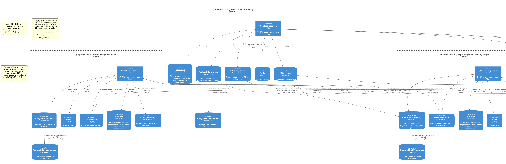

# ADR-014: Схема репликации данных между регионами

- **Автор:** Дмитрий Ренев
- **Статус:** На согласовании
- **Согласующие:** Дмитрий Бардин
- **Дата:** 2026-10-16
- **Связанные артефакты:** [ADR-013-deployment-regions.md](ADR-013-deployment-regions.md), [ADR-008-kafka-topics-and-partitioning.md](../../Task2/adr/ADR-008-kafka-topics-and-partitioning.md), [ADR-011-reliable-delivery.md](../../Task2/adr/ADR-011-reliable-delivery.md), [ADR-016-failover.md](ADR-016-failover.md), [ADR-017-compliance.md](ADR-017-compliance.md), [replication.puml](../diagrams/replication.puml)

---

## Контекст

Платформа разворачивается в **5 суб-регионах** (`base`, `sea-sg`, `sea-id`, `sa-br`, `sa-cl`) трёх макро-регионов (ADR-013) с моделью **active-active для stateless-сервисов** и **региональными БД** для stateful-данных. Требуется определить **схему репликации данных между регионами** с учётом:

- **резидентности PII** (NFR-C-01): персональные данные не покидают регион присутствия без правового основания;
- **RPO ≤ 1 мин, RTO ≤ 15 мин** для критичных данных (NFR-A-04);
- **доступности 99,99 %** (NFR-A-01) - исключение единых точек отказа;
- **eventual consistency** между регионами (NFR-D-01), at-least-once и идемпотентность (ADR-011).

Данные уже не единый монолит: это `database-per-service` плюс событийная платформа на Kafka с region-aware партиционированием (ADR-008).

## Требования

1. Классифицировать данные по **классу резидентности** и задать для каждого класса политику репликации.
2. Для каждого хранилища определить: **внутрирегиональную** (HA) и **межрегиональную** (DR/глобальная) репликацию, режим (sync/async) и направление.
3. Гарантировать **RPO ≤ 1 мин** для критичных данных и **отсутствие единой точки отказа**.
4. Не допускать выхода PII за пределы допустимого периметра (страна/макро-регион).
5. Обеспечить **восстановление после отказа региона** (promote/replay) в рамках RTO.
6. Сохранить совместимость с region-aware ключами Kafka (ADR-008).

## Решение

### Классификация данных

| Класс | Примеры | Резидентность | Где живёт primary |
|-------|---------|---------------|-------------------|
| **PII / регулируемые** | Профили и документы водителей, пассажиров, платежные реквизиты | Строго в стране/регионе | Региональная БД | 
| **Операционные** | Состояние поездки, брони, смены, котировки | Регион + DR в паре | Региональная БД |
| **События** | Доменные события | Region-scoped | Региональный Kafka |
| **Справочные** | Геозоны, шаблоны правил ценообразования, Schema Registry | Глобально (не PII) | Глобальный слой |
| **Аналитические** | Витрины, агрегаты | Деидентифицировано | Региональный ClickHouse → глобальная аналитика |

Ключевой принцип: **данные привязаны к макро-региону пользователя/сущности** (`regionId`), совпадающему с партиционированием Kafka (ADR-008), и физически размещаются в конкретном **суб-регионе** (`subRegionId`, ADR-013). Партиционирование события - по `regionId:aggregateId`; выбор суб-региона для размещения/маршрутизации - по `subRegionId`.

### Модель репликации по слоям

| Слой | Внутри региона (HA) | Между регионами | Режим | Комментарий |
|------|---------------------|-----------------|-------|-------------|
| **PostgreSQL (критичные БД)** | Multi-AZ синхронная реплика | Асинхронная реплика в парный суб-регион макро (DR) | sync intra-subRegion, async intra-macro | RPO=0 при отказе AZ (sync); RPO "best-effort" при отказе суб-региона (async, см. тайминги) |
| **Kafka** | replication.factor=3, min.insync=2 (`acks=all`) | Cross-region mirroring для region-scoped топиков и общих топиков | async | MirrorMaker-класс / cluster linking |
| **Redis (кеш)** | Репликация в рамках региона | Нет | - | Кеш восстанавливаем, глобальная реплика не нужна |
| **Elasticsearch (геоиндекс)** | Мульти-нода в регионе | Локальный пересбор из Kafka/БД | - | Поисковый индекс перестраиваем из источника |
| **ClickHouse (аналитика)** | Мультиреплика в регионе | Деидентифицированные агрегаты в глобальную аналитику | async (batch/stream) | Не содержит сырых PII за пределами региона |
| **Object storage (бэкапы)** | Мульти-AZ | Cross-region репликация бэкапов | async | Бэкапы могут содержать PII → репликация только в пределах макро-региона (ADR-017); для `base` - бэкапы в стране (RPO ≥ 24 ч) |
| **Container Registry (образы)** | Мульти-AZ | Cross-region репликация образов | async | Образы не содержат PII |
| **Секреты** | Репликация в пределах региона | Отдельные инстансы per-region | - | Ключи per-region (см. ADR-018) |

> **Object storage в системе.** Помимо репликации образов/бэкапов, object storage используется как **неизменяемый аудит-стор** (WORM / Object Lock, append-only, retention ≥ 1 год) - отдельный компонент, описанный в **ADR-018**.

### PII и резидентация

- **Primary по стране.** Каждый суб-регион - **primary для данных своей страны присутствия** (Индонезия → `sea-id`, Сингапур → `sea-sg`; Бразилия → `sa-br`, Чили → `sa-cl`). Резидентные PII одной страны **не дублируются в чужой суб-регион как копия primary**; второй регион пары не является "пассивным DR" для чужой резидентной базы.
- **PII-БД** реплицируются **только между суб-регионами одного макро-региона** (например, `sea-id` ↔ `sea-sg`) при наличии правового основания и защитного шифрования - и только для **разрешённой к репликации (не резидентно-ограниченной) части** данных; резидентные PII могут **не реплицироваться вовсе**, и тогда DR обеспечивается резервными копиями в стране.
- **Кросс-региональная репликация PII** (между разными макро-регионами, в т.ч. `base` ↔ `sea`/`sa`) **запрещена** - включается только через контролируемый шлюз с проверкой правового основания (ADR-017). Для `base` межмакрорегиональная репликация PII **не выполняется**; DR - резервные копии в стране (и парный суб-регион base в перспективе).
- **Деидентификация** обязательна перед записью в глобальную аналитику (маскирование/токенизация PII).

### Событийная репликация (Kafka)

- Каждый регион - **свой Kafka-кластер**; партиционирование и регион в ключе сохраняются (ADR-008).
- **MirrorMaker-класс / cluster linking** переносит только нужные топики: общие/глобальные (справочники, деидентифицированные события) и DR-реплику региональных.
- Потребители идемпотентны (ADR-011); лаг репликации - SLI.
- Для финансовых доменов - приоритет durability (min.insync=3) и контроль лага.

### Схема репликации

5 суб-региональных границ с региональными БД и Kafka, глобальный слой справочников и деидентифицированной аналитики, intra-subRegion sync и intra-macro async потоки.

### Режимы и тайминги (целевые)

| Метрика | Цель | Как достигается |
|---------|------|-----------------|
| RPO - отказ AZ (intra-subRegion) | **0** | Синхронная репликация в AZ-наборе |
| RPO - отказ суб-региона (intra-macro, async) | **≤ 1 мин** (best-effort) | Async-реплика + replay Kafka; promote разрешён только при lag ≤ RPO |
| RPO - межмакрорегиональный DR | **≥ 24 ч** (только бэкапы) | PII не реплицируется между макро-регионами (резидентность) |
| RTO (суб-регион) | ≤ 15 мин (hot standby: ≤ 5 мин) | Promote реплики + переключение геомаршрутизации (ADR-015, ADR-016) |
| Лаг межрегиональной репликации | ≤ 60 с (цель), алерт > 60 с | Метрики репликации + burn-rate алерты |

> **Реализм RPO:** RPO=0 достижим только внутри суб-региона (синхронно, multi-AZ). Для отказов **целого суб-региона** репликация асинхронная и RPO ≤ 1 мин является **целевым/бест-эффорт**, а не гарантией; фактическая потеря ограничивается лагом и контролируется гейтом promote (ADR-016). Между макро-регионами гарантируется только резервное копирование.

## Альтернативы

1. **Глобальная единая БД (single global primary).** Простая консистентность, но нарушает резидентность PII, создаёт SPOF и высокую задержку для удалённых регионов.
2. **Полный active-active multi-master на уровне БД.** Минимальный RTO, но дорого, сложно разрешать конфликты и трудно соблюсти резидентность.
3. **Репликация только внутри региона без DR.** Дёшево, но при отказе региона данные недоступны → SLA не достигается.
4. **Синхронная межрегиональная репликация PII.** Консистентно, но добавляет задержку и нарушает резидентность/правовые ограничения.
5. **Физическая по-регионная изоляция с полным отсутствием обмена (только backup).** Максимальная резидентность, но неприемлемый RTO/RPO и потеря глобальных функций (справочники, аналитика).

## Компромиссы и риски

- **Eventual consistency между регионами** - часть сценариев (глобальные отчёты, горячие геозоны) запаздывает; принимается осознанно (NFR-D-01).
- **Асинхронная межрегиональная репликация** → потенциальная потеря данных в пределах RPO при жёстком отказе региона; митигация - синхронная реплика в AZ и частые бэкапы.
- **Резидентность усложняет DR для PII:** при отказе страны-владельца PII возможен только ограниченный набор действий; требуется правовая проработка (ADR-017).
- **Стоимость межрегионального трафика** (egress) и mirroring - учитывается FinOps; фильтрация топиков для mirroring снижает объём.
- **Операционная сложность** мультирегиональной репликации и promote-процедур; митигация - runbook и регулярные учения (ADR-016).
- **Разрастание объёма реплицируемых данных** при росте рынков; митигация - партиционирование и селективная репликация.

## Допущения

- Managed-сервисы БД и Kafka поддерживают требуемые режимы репликации (sync/async) и cross-region mirroring в целевых локациях.
- Правовые основания для DR-репликации PII внутри макро-региона подтверждаются комплаенс-командой по каждой стране (ADR-017).
- Глобальная аналитика оперирует только деидентифицированными данными.
