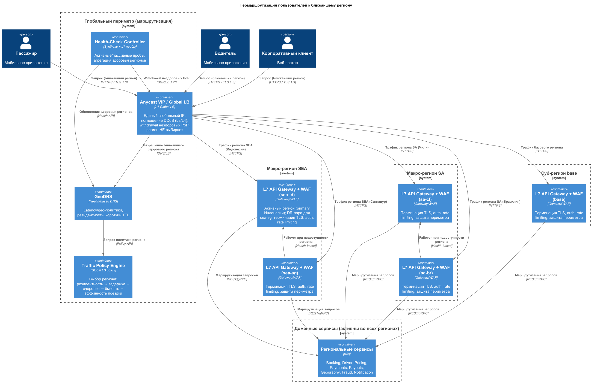

# ADR-015: Геомаршрутизация пользователей к ближайшему региону

- **Автор:** Дмитрий Ренев
- **Статус:** На согласовании
- **Согласующие:** Дмитрий Бардин
- **Дата:** 2026-10-16
- **Связанные артефакты:** [ADR-013-deployment-regions.md](ADR-013-deployment-regions.md), [ADR-014-data-replication.md](ADR-014-data-replication.md), [ADR-016-failover.md](ADR-016-failover.md), [ADR-008-kafka-topics-and-partitioning.md](../../Task2/adr/ADR-008-kafka-topics-and-partitioning.md), [georouting.puml](../diagrams/georouting.puml)

---

## Контекст

Пользователи GoFuture находятся в **базовом регионе**, **Юго-Восточной Азии** и **Южной Америке**; платформа развёрнута в **5 суб-регионах** трёх макро-регионов (ADR-013) с региональными данными (ADR-014). Требуется **механизм геомаршрутизации**, который направляет каждого пользователя к **ближайшему healthy суб-региону**, обеспечивая:

- **низкую задержку** критичных сценариев (NFR-P-02, NFR-P-03);
- **резидентность**: пользователь попадает в регион, где хранятся его данные (NFR-C-01);
- **доступность 99,99 %**: мгновенное исключение unhealthy региона без участия человека (NFR-A-01, NFR-A-05).

Особенность домена такси: клиент и водитель одной поездки должны попасть в **один регион** (общая сессия поездки, matching, `regionId:aggregateId` из ADR-008). Поэтому маршрутизация - не только "ближайший", но и "резидентный/консистентный по поездке" выбор.

## Требования

1. Направлять пользователя к **ближайшему healthy** региону; латентность - приоритетный критерий.
2. Обеспечивать **региональную привязку** (данные и сессия поездки пользователя).
3. Мгновенно исключать unhealthy регион (**health-based failover**) без ручных действий.
4. Поддерживать **TLS/шифрование**, WAF и защиту периметра на входе (ADR-018).
5. Работать глобально, **без привязки к конкретному облачному провайдеру**.
6. Устойчивость к отказу **самого механизма** маршрутизации (отсутствие SPOF).
7. Поддержка мобильных клиентов и корпоративного веб-портала.

## Решение

Применяется **гибридная многослойная схема**: **Global LB (anycast/IP) → GeoDNS (latency/geo-based) → региональный L7 API Gateway с WAF и health-checks**. Слои сочетаются, а не исключают друг друга - anycast даёт быстрый вход и устойчивость, GeoDNS/L7 - гибкую политику, резидентность и "мягкий" failover.

### Слои маршрутизации

| Слой                              | Механизм | Назначение                                                                                                                                  |
|-----------------------------------|----------|---------------------------------------------------------------------------------------------------------------------------------------------|
| L0 - Вход                         | **Anycast VIP / Global LB** (единый глобальный IP) | Быстрый заход из любой точки (L3/L4), поглощение DDoS, мгновенный withdrawal unhealthy PoP. **Суб-регион и TLS на этом слое не выбираются** |
| L1 - Разрешение                   | **GeoDNS** (latency-based + гео-политики) | Для клиентов/сценариев без anycast - возвращает адрес ближайшего **healthy** суб-региона с учётом резидентности (страна → суб-регион)       |
| L2 - Выбор суб-региона            | **Traffic Policy Engine** (L7) | **Финальное** решение о суб-регионе: резидентность → задержка → healthcheck → ёмкость → региональная привязка                               |
| L3 - Терминация/региональный шлюз | **L7 API Gateway / BFF + WAF** | **Терминация TLS** (на выбранном суб-регионе, не на anycast-PoP), аутентификация, rate limiting, маршрутизация к сервисам                   |
| L4 - Сервисы                      | Региональные доменные сервисы | Обработка в суб-регионе, где живут данные                                                                                                   |

### Разграничение ролей Anycast и GeoDNS

Anycast и GeoDNS **не дублируют** решение о регионе; у них разные роли:

- **Anycast/Global LB (L0)** принимает трафик на ближайшем PoP и обеспечивает устойчивость (DDoS, withdrawal); он **не выбирает** суб-регион по резидентности.
- **GeoDNS (L1)** - механизм разрешения эндпоинта для клиентов, не использующих anycast-вход (или как страховка при отказе PoP).
- **Traffic Policy Engine (L2)** - единая точка **принятия решения** о суб-регионе; сюда сходятся входы (anycast/PoP, GeoDNS, health) и критерии выбора. Это исключает конфликт двух независимых механизмов.

**TLS и передача региональной привязки.** TLS **терминируется на L7-шлюзе выбранного суб-региона** (не на anycast-PoP): anycast работает на L3/L4 и пропускает зашифрованный поток к региональному шлюзу. Поскольку решение о суб-регионе принимается на L7 (после терминации), "залипание" поездки (пара `regionId`+`subRegionId`) реализуется на этом же слое - например, через подписанный affinity-токен/заголовок, который шлюз проверяет и при необходимости пинит к региону активной поездки. Это снимает неоднозначность "кто и на каком слое принимает финальное решение и где терминируется TLS".

### Комбинирование критериев выбора суб-региона

1. **Резидентность** (жёсткое правило): пользователь из Индонезии → `sea-id`, из Бразилии → `sa-br`; страна в маршрутной политике первична.
2. **Близость/задержка**: при отсутствии жёсткого резидентного требования - минимальный RTT.
3. **Helathy суб-региона**: unhealthy исключается из решений (health-based).
4. **Региональная привязка поездки**: клиент и водитель активной поездки направляются в один и тот же суб-регион (пара `regionId`+`subRegionId`); маршрутизация "залипает" на время поездки.
5. **Ёмкость/деградация**: при перегрузке суб-региона - распределение на парный суб-регион макро-зоны (с деградацией задержки).

### Health-checks и переключение

- **Активные пробы** (L7 `/health`, синтетические транзакции) + **пассивные** (ошибки, latency) на каждом региональном шлюзе.
- **Health-based DNS** с коротким TTL и **anycast withdrawal** unhealthy PoP.
- **Автоматический failover** без человека: при деградации региона Global LB/DNS перестаёт отдавать его адрес; клиент получает регион-пару макро-зоны (см. сценарии в ADR-016).
- **Drain/graceful shutdown** при плановых работах.

### Региональная привязка и консистентность

- В клиентском токене/сессии фиксируется пара `regionId`+`subRegionId` (ADR-013); запросы активной поездки маршрутизируются в этот суб-регион, даже если пользователь физически ближе к другому.
- Синхронные межсервисные вызовы критичного пути (Booking → Driver/Geography/Pricing) остаются **внутри региона**; межрегиональные вызовы - только для не-критичных/асинхронных сценариев.

### Схема геомаршрутизации

Слои и потоки: клиенты → anycast/Global LB → GeoDNS-разрешение → региональные шлюзы с WAF → сервисы; отдельно - health-checks и failover-путь в регион-пару.

## Альтернативы

1. **Только GeoDNS (без anycast).** Проще, но медленная сходимость DNS (TTL), нет мгновенного failover и защиты от отказа PoP.
2. **Только anycast/BGP на L4.** Минимальная задержка и мгновенный failover, но сложнее с TLS-политиками, WAF и резидентностью на уровне L7.
3. **Сторонний глобальный LB/CDN с Proprietary GSLB.** Быстро внедряется, но вендор-лок, ограничение cloud-agnostic.
4. **Статическая маршрутизация по стране без health-check.** Проста, но не даёт автоматического failover - несовместима с 99,99 %.
5. **Клиентская маршрутизация (hard-coded endpoints).** Не требует инфраструктуры, но негибка, небезопасна и ломается при отказе региона.

## Компромиссы и риски

- **Сложность трёх слоёв.** anycast + DNS + L7 требуют согласованной конфигурации; митигация - IaC, тесты конфигурации, runbook.
- **Кэширование DNS у клиентов** может задержать реальный failover; митигация - короткий TTL, anycast-withdrawal, ретраи на клиенте, "мягкий" L7-failover.
- **Резидентность vs задержка:** жёсткое резидентное правило может направить пользователя в чуть более дальний регион; требованием приоритет - резидентность для PII.
- **Региональная привязка поездки** усложняет балансировку (пользователь "закреплён" за регионом); при отказе региона активная поездка мигрирует по процедуре ADR-016.
- **Отказ самого GeoDNS/Global LB** - потенциальный SPOF; митигация: anycast с несколькими PoP, независимые DNS-провайдеры, статические резервные ответы.
- **Стоимость** anycast/global LB и межрегионального трафика (FinOps).

## Допущения

- Выбранные провайдеры предоставляют anycast/global LB и health-based DNS либо эквивалент (cloud-agnostic).
- Мобильные клиенты поддерживают ретраи и переразрешение DNS при ошибках.
- Региональная привязка фиксируется в auth-токене на стороне геомаршрутизатора.
