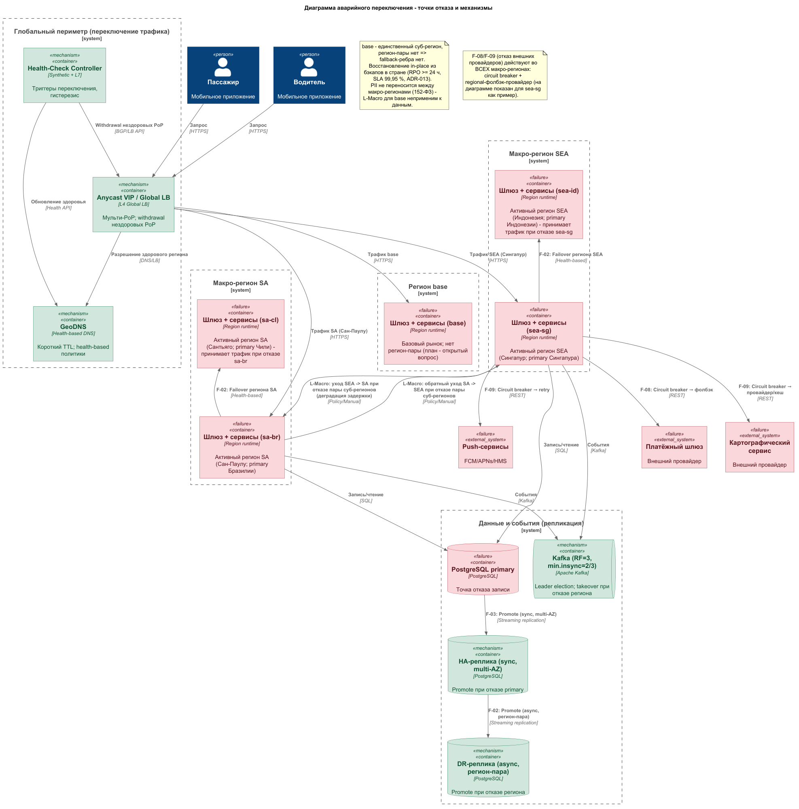

# ADR-016: Аварийное переключение (failover), точки отказа и сценарии

- **Автор:** Дмитрий Ренев
- **Статус:** На согласовании
- **Согласующие:** Дмитрий Бардин
- **Дата:** 2026-10-16
- **Связанные артефакты:** [ADR-013-deployment-regions.md](ADR-013-deployment-regions.md), [ADR-014-data-replication.md](ADR-014-data-replication.md), [ADR-015-geo-routing.md](ADR-015-geo-routing.md), [ADR-018-security-landscape.md](ADR-018-security-landscape.md), [ADR-001-nfr.md](../../Task1/adr/ADR-001-nfr.md), [failover.puml](../diagrams/failover.puml)

---

## Контекст

Требуется **план аварийного переключения (failover)** для глобального развёртывания в **5 суб-регионах** трёх макро-регионов
(ADR-013) с целью достижения **99,99 % доступности** и **низкой задержки**. Нужно определить **основные точки отказа** и 
**механизмы переключения**, а также представить **диаграмму аварийного переключения** и **таблицу сценариев отказа**.

Целевые метрики (ADR-001): **RTO ≤ 15 мин**, **RPO ≤ 1 мин**, региональный failover **≤ 5 мин**, MTTR ≤ 15 мин.

Слои системы, которые могут отказать: периферия (Anycast/GeoDNS), региональные шлюзы (WAF/L7), доменные сервисы (stateless), брокер событий (Kafka), хранилища (PostgreSQL, Redis, Elasticsearch, ClickHouse), внешние интеграции (платежи, карты, push), глобальный control plane и наблюдаемость.

## Требования

1. Выявить **точки отказа** по всем слоям и устранить единые точки (SPOF).
2. Задать **механизмы автоматического переключения** для локального (AZ), регионального и макрорегионального уровней.
3. Обеспечить **отсутствие dual-primary / split-brain** при сетевых партициях.
4. Уложиться в целевые **RTO/RPO**.
5. Обеспечить **наблюдаемость и триггеры** переключения (метрики, health, алерты).
6. Определить **деградацию** (какие функции ограничиваются) при частичном отказе.
7. Регламентировать **runbook и регулярные учения** (game days).

## Решение

### Уровни избыточности и переключения

| Уровень | Что отказало | Механизм | Тип |
|---------|--------------|----------|-----|
| **L-AZ** | Зона доступности (AZ) | Multi-AZ расстановка + авто-failover managed-сервисов | Автоматический |
| **L-Region** | Регион целиком | Геомаршрутизация на регион-пару + promote реплики + takeover потребителей | Автоматический (health-based) |
| **L-Macro** | Пара регионов макро-зоны | Перенаправление в другой макро-регион с деградацией задержки | Автоматический/полуавтоматический |
| **L-Global** | Глобальный сервис (DNS/LB) | Anycast multi-PoP + независимые DNS + статические резервные ответы | Автоматический |
| **L-Data** | Повреждение данных | PITR бэкапы + replay Kafka | Полуавтоматический |

### Точки отказа и механизмы (сводно)

| Слой | Точка отказа | Механизм переключения |
|------|--------------|-----------------------|
| Периферия | PoP/узел Anycast, зона GeoDNS | Несколько PoP, любойcast-withdrawal, независимые DNS-провайдеры, статические резервные записи |
| Региональный шлюз | Экземпляр L7/WAF | Несколько реплик шлюза, LB внутри региона, авто-replace (K8s) |
| Сервисы (stateless) | Pod/нода | Рестарт/перепланирование в K8s, HPA, несколько реплик во всех регионах |
| Kafka | Broker/лидер партиции | RF=3, min.insync=2(3), leader election; при отказе региона - takeover потребителями в регионе-паре |
| PostgreSQL | Primary | Promote синхронной HA-реплики (intra-AZ); при отказе региона - promote межрегиональной DR-реплики |
| Redis | Нода/шард | Реплики в регионе, пересбор кеша из источника |
| Elasticsearch | Нода/шард | Реплики шардов, пересбор геоиндекса |
| ClickHouse | Нода | Реплики, деградация аналитики (не критично) |
| Внешние интеграции | Провайдер платежей/карт/push | Circuit breaker, таймауты, retry с backoff, региональный фолбэк-провайдер |
| Control plane/CI | Отказ управления | Immutable-деплой, кэш конфигураций, "break-glass" доступ |
| Наблюдаемость | Отказ мониторинга | Резервный путь алертов, автономный health на периферии |
| Данные | Логическая порча | PITR, верифицированные бэкапы, replay Kafka (retention) |

### Защита от split-brain

- При сетевой партиции между регионами - **никакого dual-primary**: региона-владельца данных остаётся один (кворум/лидер), второй переходит в **degraded/read-mostly** режим.
- Блокировка старого лидера при назначении нового, исключающая возможность одновременной записи из двух регионов.
- Геомаршрутизация при партиции направляет новых пользователей в доступный регион; активные поездки обслуживаются по правилам региональной привязки (ADR-015).

### Механизмы устойчивости приложения

- **Circuit breaker + timeout + retry (backoff + jitter)** на всех межсервисных и внешних вызовах (NFR-A-02).
- **Bulkhead** (изоляция пулов) и **load shedding** (приоритезация критичного пути: booking/matching выше аналитики).
- **Idempotency** на всех шагах саг (ADR-010/ADR-011) - дубликаты при failover безопасны.

### Триггеры переключения

| Триггер | Порог (пример) | Действие |
|---------|----------------|----------|
| Health-check региона | ≥ N последовательных неуспехов | Исключение региона из балансировки |
| Latency SLI | p99 > порога X мин | Уход трафика в регион-пару |
| Error rate | > SLO burn-rate за окно | Алерт + авто-переключение при устойчивом превышении |
| Внешний провайдер | Ошибки > X % за окно | Circuit breaker → фолбэк |
| Репликационный лаг | > 60 с | Алерт, блокировка promote (защита от потери > RPO) |

### Схема аварийного переключения

Глобальный периметр, макро-регионы с DR-парами, точки отказа (отмечены как неустойчивые узлы) и механизмы переключения.

### Таблица сценариев отказа

| ID | Сценарий | Точка отказа | Влияние | Механизм переключения | RTO | RPO | Деградация |
|----|----------|--------------|---------|-----------------------|-----|-----|-----------|
| F-01 | Отказ зоны доступности | AZ | Часть реплик недоступна | Multi-AZ авто-failover managed-сервисов | сек–мин | 0 | Нет |
| F-02 | Отказ суб-региона целиком | Суб-регион | Недоступны шлюз, сервисы, БД, Kafka суб-региона | Геомаршрутизация на суб-регион-пару; promote DR-реплики; takeover потребителей | ≤ 5 мин (hot standby) / ≤ 15 мин | ≤ 1 мин (best-effort) | Рост задержки (соседний суб-регион), часть чтений позже сходится |
| F-03 | Отказ primary БД | Узел БД | Записи в регионе недоступны | Promote синхронной HA-реплики | сек–мин | 0 | Кратковременный рост ошибок записи |
| F-04 | Отказ Kafka-брокера/лидера | Брокер | Задержка обработки событий | Leader election, RF-реплики | сек | 0 | Возможный рост lag |
| F-05 | Отказ суб-региона + Kafka | Kafka суб-региона | События не публикуются в суб-регионе | Mirror-кластер в суб-регион-паре, takeover consumer groups | ≤ 5–10 мин (hot standby) | ≤ 1 мин (best-effort) | Рост lag, отложенная обработка |
| F-06 | Отказ GeoDNS/Global LB | Периферия | Клиенты не разрешают адрес | Anycast multi-PoP, независимые DNS, статические резервные ответы | сек–мин | 0 | Рост задержки при уходе на дальний PoP |
| F-07 | Отказ ноды/Pod сервиса | Compute | Потеря реплики | Рестарт/перепланирование в K8s, HPA | сек–мин | 0 | Нет при запасе реплик |
| F-08 | Отказ внешнего провайдера платежей | Внешняя система | Платежи не проходят | Circuit breaker → фолбэк/очередь, retry | мин | 0 | Часть платежей отложена (асинхронно) |
| F-09 | Отказ провайдера карт/push | Внешняя система | Гео/уведомления деградируют | Circuit breaker, региональный альтернативный провайдер, кеш | мин | 0 | ETA/уведомления с задержкой |
| F-10 | Сетевая партиция между регионами | Сеть | Возможен split-brain | Fencing + region-local degraded-режим, запрет dual-primary | мин | ≤ 1 мин | Регион-жертва read-mostly |
| F-11 | Отказ control plane/CI | Платформа | Нельзя деплоить/менять конфиг | Immutable-деплой, кэш конфигураций, break-glass | часы (не влияет на трафик) | 0 | Задержка релизов |
| F-12 | DDoS/абуз | Периферия | Перегрузка входа | WAF, scrub-центр, rate limiting, автоскейл | мин | 0 | Возможна деградация части клиентов |
| F-13 | Отказ мониторинга/алертинга | Observability | "Слепая" эксплуатация | Резервный путь алертов, автономные health-пробы на периферии | мин | 0 | Ухудшение диагностики |
| F-14 | Логическая порча/удаление данных | Данные | Некорректные данные | PITR-восстановление + replay Kafka | ≤ RTO | ≤ RPO | Ограничение записи на время восстановления |

> **Оговорка по RTO/RPO.** Значения ≤ 5 мин (F-02) и ≤ 5–10 мин (F-05) предполагают **hot standby**: предпрогретые реплики, takeover consumer groups и быстрый health-based withdraw (anycast/DNS с коротким TTL). Без hot standby переключение укладывается в общий **RTO ≤ 15 мин**. RPO при отказе суб-региона - **best-effort ≤ 1 мин** (асинхронная репликация); promote блокируется при репликационном лаге > RPO. Для `base` (нет суб-регион-пары) сценарий F-02 применим как деградированный: восстановление из бэкапов в стране (RPO ≥ 24 ч, SLA 99,95 % - ADR-013).
>
> Пороговые значения (N, X, окна) - предварительные; уточняются при настройке SLI/SLO (ADR-012).

### Процедура и учения

- **Runbook** по каждому сценарию (F-01…F-14): триггер → шаги → критерии успеха → откат.
- **Автоматизация** где возможно (health-based routing, promote, HPA); ручные шаги - только для L-Data и L-Macro.
- **Регулярные game days** (учения по отказу региона, БД, Kafka, провайдера) - минимум раз в квартал; проверка RTO/RPO.
- **Post-mortem** после каждого инцидента/учений (blameless), обновление runbook.

## Альтернативы

1. **Active-passive по всему макро-региону (warm standby).** Проще консистентность и дешевле трафик, но выше RTO (cold promotion) и не даёт низкой задержки active-active.
2. **Только автоматический intra-region failover без регионального.** Не обеспечивает 99,99 % при отказе всего региона.
3. **Ручное переключение региона (on-call).** Проще реализовать, но RTO не укладывается в ≤ 5 мин, высок риск человеческой ошибки.
4. **Один "большой" регион на макро-зону.** Дешевле, но не выполняет требование >3 регионов и повышает радиус поражения.
5. **Полностью автоматический failover всех слоёв, включая данные.** Снижает MTTR, но повышает риск "ложных" переключений и split-brain; для данных оставлен полуавтоматический режим с fencing.

## Компромиссы и риски

- **Автоматический региональный failover повышает риск "мигающих" переключений** (flapping); митигация - гистерезис, устойчивый порог, ручное подтверждение для неоднозначных случаев.
- **Promote межрегиональной DR-реплики** может привести к потере данных в пределах RPO; защита - блокировка promote при лаге > RPO.
- **Split-brain** - самый опасный риск; митигация - fencing, кворум, запрет dual-primary, region-local деградация.
- **Рост задержки** для пользователей переключённого региона/макро-зоны; принимается как осознанная деградация.
- **Стоимость** избыточности (дублирование, трафик, warm-ёмкость) - FinOps.
- **Наблюдаемость мультирегиона** сложна (единый обзор, корреляция через `correlationId`); покрывается ADR-012 и отдельными SLI репликации.
- **Человеческий фактор** в ручных шагах; митигация - runbook, автоматизация, game days.

## Допущения

- Managed-сервисы поддерживают multi-AZ и cross-region promote/failover с контролем лага.
- Геомаршрутизация (ADR-015) выполняет health-based переключение периферии.
- Внешние интеграции имеют (или допускают) региональный фолбэк-провайдер.
- Пороговые значения и окна будут уточнены по результатам SLO (ADR-012) и учений.
