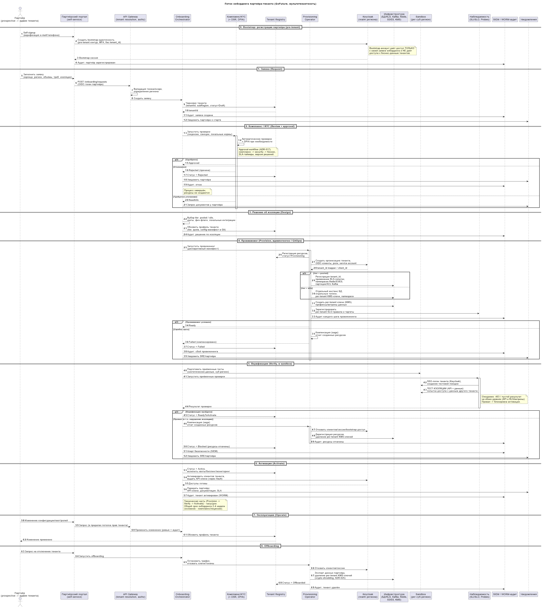

# ADR-027: Автоматизированный онбординг партнёров (мультитенантность)

- **Автор:** Дмитрий Ренев
- **Статус:** На согласовании
- **Согласующие:** Дмитрий Бардин
- **Дата:** 2026-10-18
- **Связанные артефакты:** [ADR-001-nfr.md](../../Task1/adr/ADR-001-nfr.md), [ADR-013-deployment-regions.md](../../Task3/adr/ADR-013-deployment-regions.md), [ADR-016-failover.md](../../Task3/adr/ADR-016-failover.md), [ADR-017-compliance.md](../../Task3/adr/ADR-017-compliance.md), [ADR-018-security-landscape.md](../../Task3/adr/ADR-018-security-landscape.md), [ADR-024-data-residency.md](../../Task4/adr/ADR-024-data-residency.md), [ADR-025-tenant-isolation.md](ADR-025-tenant-isolation.md), [ADR-026-iam-keycloak-rbac.md](ADR-026-iam-keycloak-rbac.md), [ADR-028-multitenant-monitoring.md](ADR-028-multitenant-monitoring.md), [roles-and-access-matrix.md](../roles-and-access-matrix.md), [c2-to-be.puml](../diagrams/c2-to-be.puml), [partner-onboarding.puml](../diagrams/partner-onboarding.puml)

---

## Контекст

Цель бизнеса - **запуск партнёра в новом регионе за 2–4 недели вместо полугода**. Это означает, что процесс подключения партнёра-тенанта (ADR-025) должен быть **автоматизированным, повторяемым и аудируемым**, а не проектом "под ключ" силами инженеров.

Что необходимо создать при подключении партнёра (по ADR-025/026/028):

- запись тенанта в реестре (регион, tier изоляции, квоты, конфигурация);
- tenant-скоуп в **Keycloak** (organizations/группы, клиенты, роли, service accounts, scopes);
- изоляция данных: **pooled** (регистрация `tenant_id`, RLS-политики, namespaces) или **silo** (инстанс БД, топики, KMS-ключи, namespace);
- ресурсы событийной платформы (партиционирование/ACL/квоты Kafka), кеша, объектного хранилища, поиска;
- **конфигурация и фича-флаги**, брендинг, локальные интеграции (платёжный провайдер, карты) (кастомизация);
- **квоты и учёт потребления** (Quota & Usage Metering) для биллинга и защиты от шумного соседа;
- **правила мониторинга и алертинга** на тенанта, per-tenant SLI/SLO (ADR-028);
- **API-ключи/клиенты** для партнёрского API;
- готовый **аудит** каждого шага и возможность **offboarding**.

Существующая инфраструктурная команда выполняла масштабирование **вручную по алертам**, поэтому ручной провижининг здесь - источник задержек и ошибок.

## Требования

1. **Self-service**: партнёр подаёт заявку через портал/API, без переписки и ручных задач инженеров на "счастливом пути".
2. **Approval-workflow**: юридические/комплаенс- и security-проверки с SLA-таймерами и контролем версий решений (ADR-017).
3. **Декларативный идемпотентный провижининг**: единый контракт (Git as source of truth), одинаково применимый к pooled- и silo-тенантам (ADR-025).
4. **Верификация**: автоматические приёмочные проверки, включая **проверку изоляции** (свой/чужой тенант) до активации.
5. **Наблюдаемость процесса и SLA** самого онбординга; аудит каждого шага (ADR-018/028).
6. **Откат/компенсация** при сбое провижининга (нельзя оставить "полу-созданный" тенант).
7. **Управляемая эволюция** тенанта: изменение конфигурации/квот/ролей, повышение tier, **offboarding** с crypto-shredding (ADR-025).
8. Целевой срок технической части провижининга - **часы/дни**, общий срок онбординга - **2–4 недели** (остальное - комплаенс/лицензии).

## Решение

### Общая архитектура: Control Plane (Tenant Plane) поверх доменных сервисов

Добавляется **Control Plane мультитенантности** - набор контейнеров, управляющих жизненным циклом тенантов, отдельно от data plane (доменных сервисов):

| Компонент | Роль |
|-----------|------|
| **Partner Self-service Portal** | Заявка партнёра, статус онбординга, конфигурация и self-service использование (usage, SLO, API-ключи) |
| **Onboarding Orchestrator** | Workflow-движок: состояния заявки, approval-шаги, SLA-таймеры, компенсации (saga онбординга) |
| **Tenant Registry** | Система-рекорд тенантов: `tenantId`, суб-регион, tier изоляции, статус, квоты, конфигурация, владелец, ссылки на ресурсы |
| **Provisioning Operator** | Идемпотентный провижининг ресурсов по декларативному контракту (IaC-контроллер) |
| **Tenant Config Service** | Раздача конфигурации/фича-флагов/брендинга в сервисы и клиентов, версии конфигураций |
| **Quota & Usage Metering** | **Единственный владелец** квот и учёта потребления на тенанта (ADR-025/028 только потребляют значения); питает биллинг и защиту от шумного соседа; идемпотентный учёт (billing-grade) |
| **Sandbox (per суб-регион)** | Изолированная среда для приёмочных тестов онбординга (SSO, тестовая поездка, тест изоляции); синтетические данные, покрытие резидентности |

### Жизненный цикл онбординга (фазы)

| № | Фаза | Что происходит | Автоматизация | Типовой срок |
|---|------|----------------|---------------|--------------|
| 0 | **Регистрация партнёра (bootstrap-идентичность)** | Prospective-партнёр создаёт **bootstrap-учётную запись** (self-signup с верификацией e-mail/телефона и MFA) **до** появления тенанта; верифицируется привязка к юрлицу | Портал (self-signup flow Keycloak) + верификация контакта/домена | часы |
| 1 | **Заявка (Request)** | Партнёр заполняет заявку в портале/через API: юрлицо, регион, объёмы, требования изоляции, платёжные реквизиты | Портал + валидация схемы, создание черновика в Tenant Registry | часы |
| 2 | **Комплаенс/KYC (Review)** | Проверки: лицензии (перевозки/платежи), санкции, локальные требования; DPIA при необходимости (ADR-017) | Автоматические проверки + **approval-workflow** (комплаенс → security → бизнес) с SLA-таймерами; роли-аппруверы: Compliance Reviewer, Security Approver, Business Approver ([roles-and-access-matrix.md](../roles-and-access-matrix.md)) | 1–3 недели |
| 3 | **Решение об изоляции (Design)** | По профилю выбирается tier (`pooled`/`silo`), применяются **default-квоты по tier**, IdP-настройки, локальные интеграции | Рекомендация правил + подтверждение оператором | дни |
| 4 | **Провижининг (Provision)** | Operator создаёт: тенант в Registry, Keycloak org/clients/roles/service-account, БД+RLS / silo-инстанс, топики Kafka, Redis/S3/ES namespaces, KMS-ключ, config, monitoring-rules | **Полностью автоматически**, идемпотентно (GitOps/IaC) | часы |
| 5 | **Верификация (Verify)** | Smoke-тесты: SSO-логин, создание тестовой поездки в sandbox, **тест изоляции** (чужой тенант недоступен), SLO-проверка | Автоматически; блокирует активацию при провале | часы |
| 6 | **Активация (Activate)** | Статус `Active`; включение квот/биллинга/мониторинга; выдача API-ключей и документации; уведомление партнёра | Автоматически + подтверждение | часы |
| 7 | **Эксплуатация (Operate)** | Изменения конфигурации/квот/ролей через self-service с ревью и аудитом | Автоматически | - |
| 8 | **Offboarding** | Остановка трафика, отзыв токенов/ключей, экспорт данных партнёру, crypto-shredding (ADR-025) | Полуавтоматически (подтверждение) | дни |

### Bootstrap-идентичность партнёра

До появления тенанта у партнёра ещё нет организации в Keycloak, поэтому заявку нельзя подать "от лица тенанта". Решение:

- **Фаза 0:** prospective-партнёр проходит **self-signup** в **отдельном pre-tenant контуре** (отдельный `platform`/neutral realm, ADR-026) с верификацией e-mail/телефона и обязательным MFA; bootstrap-аккаунт **не имеет `tenant_id`** и **не даёт доступа к бизнес-данным** какого-либо тенанта.
- Bootstrap-идентичность даёт право **только** на подачу/просмотр своей заявки онбординга до активации.
- На фазе Provision создаётся **организация тенанта** в региональном realm; bootstrap-партнёр получает роль **Tenant Admin** уже в контексте тенанта (привязка bootstrap → tenant admin аудируется), а pre-tenant доступ отзывается.
- Мультитенантный доступ всегда требует конкретного `tenant_id` (ADR-026) - bootstrap-аккаунт под это правило не подпадает и тенантных операций не выполняет.

**Итог:** техническая часть (провижининг + верификация + активация) - **часы-дни**, что укладывается в целевые 2–4 недели, где основное время занимают комплаенс и лицензии.

### Провижининг: декларативный, идемпотентный, версионируемый

- **Git as source of truth**: описание тенанта (`tenant manifest`: регион, tier, квоты, модули, IdP, интеграции) хранится в Git-репозитории; изменение - через PR и ревью (аудит и воспроизводимость).
- **GitOps-доставка**: Operator/ArgoCD применяет манифест к кластерам, **сверяя фактическое состояние с желаемым** (reconciliation) - "дрейф" устраняется автоматически.
- **Единый контракт** с параметром `tier`:
  - `pooled`: регистрация `tenant_id`, генерация/применение RLS-политик (шаблоном, ADR-025), namespaces в Redis/S3/ES, ACL/партиции Kafka;
  - `silo`: создание отдельного инстанса БД сервиса, отдельных топиков, отдельных KMS-ключей и namespace; отдельный realm Keycloak - опционально (ADR-026).
- **Идемпотентность**: повторный запуск не создаёт дублей; каждая операция имеет идентификатор и состояние в Orchestrator.
- **Компенсация (saga онбординга)**: при сбое шага выполняются откаты (удаление наполовину созданных ресурсов, восстановление предыдущей конфигурации); тенант не попадает в `Active` без успешной верификации. **Провал верификации (Verify) также запускает компенсацию** провижининга (дерегистрация ресурсов, отзыв клиентов/секретов, удаление per-tenant ключей) - статус `Blocked` не оставляет висящих ресурсов; либо ресурсы сохраняются **осознанно** под retention/разбором инцидента с явным решением оператора и аудитом.

### Default-квоты по tier (стартовые значения)

Квоты - **часть манифеста тенанта** и **владеются исключительно Quota & Usage Metering** (ADR-025 - точки применения, ADR-028 - метрики/алерты; лимиты не дублируются). Стартовые значения (уточняются FinOps):

| Квота | pooled (default) | silo | Где применяется |
|-------|------------------|------|-----------------|
| RPS на тенанта (API GW) | 50–200 | по контракту | rate limiting + bulkhead на шлюзе |
| Конкурентные поездки | до 1 000 | по контракту | сервисы (circuit breaker на тенанта) |
| Объём БД/хранилища | 50–200 ГБ | выделенный инстанс | инфраструктура |
| Устройства (push) | до 100 000 | по контракту | Notification |
| Интенсивность партнёрского API | 10–50 RPS | по контракту | client credentials + scopes |

При приближении к лимиту - предупреждение партнёру; превышение - мягкое (rate limit) или жёсткое (по контракту).

### Sandbox-окружение

- **Sandbox разворачивается в каждом суб-регионе** (резидентность пробных данных) и доступен партнёру до и во время онбординга.
- Назначение: приёмочные smoke-тесты, **тесты изоляции** (тенант A/B), проверка SLO и локальных интеграций.
- Пробные данные - **синтетические**, ограниченного объёма, с регламентом очистки; PII реальных пользователей в sandbox запрещены (ADR-017/024).
- Результаты тестов фиксируются в аудите онбординга и являются **условием активации**.

### Учёт потребления (billing-grade)

- Usage-события идемпотентны: каждое несёт **idempotency key** (`tenant_id + event_id`); дедупликация выполняется на входе в метр.
- Учёт - **at-least-once с дедупликацией + периодическая сверка** с финансовыми системами; расхождения разбираются регламентно (не блокируют ride-flow).
- Витрины usage хранятся **отдельно от бизнес-витрин gold** (ADR-028), со своим retention и контролем доступа.

### IAM-интеграция (ADR-026)

- Provisioning Operator автоматически создаёт в **региональном realm** Keycloak:
  - organization/группу тенанта + `tenant_id` mapper в токен;
  - клиентов (мобильные/веб/партнёрский API), scopes, роли по baseline-матрице ([roles-and-access-matrix.md](../roles-and-access-matrix.md));
  - service account партнёра (client credentials) с ограниченными scopes;
  - Tenant Admin-роль первому администратору партнёра (MFA обязательна).
- Изменение ролей тенанта возможно **в пределах его "потолка"** (неизменяемые платформенные роли недоступны, ADR-026).
- Роли тенанта получают `clearance` как **набор разрешённых классов** (напр. Tenant Finance - `{L1, L4}`, Tenant Admin - `{L0..L3}`); выдача "выше потолка" и любые cross-tenant классы запрещены (ADR-026, [roles-and-access-matrix.md](../roles-and-access-matrix.md)). Платформенный cross-tenant доступ остаётся только через break-glass-роль БД (ADR-025 §2.2).

### Кастомизация "из коробки"

- **Tenant Config Service** раздаёт: брендинг, локализацию, включённые модули (фича-флаги), локальные интеграции (платёжный провайдер региона, картографический сервис), правила (налоги, лимиты).
- Конфигурация - **декларативна, версионируется в Git, ревьюируема**; ни один партнёр не требует форка кода (ADR-025).

### Безопасность, аудит и наблюдаемость онбординга

- Каждый шаг пишет **аудит-событие** (кто/что/когда/результат), события → SIEM и WORM-стор (ADR-018).
- **Секреты** (client secrets, API-ключи, KMS-ключи) выдаются через **Vault**, не хранятся в манифестах; ротация ≤ 90 дней (ADR-018).
- **Наблюдаемость пайплайна**: метрики длительности фаз, число застрявших заявок, ошибки провижининга, SLA-алерты (ADR-028).
- **Приёмочные проверки** включают **тест изоляции**: автоматические синтетические probes подтверждают, что тенант не видит чужие данные (ADR-025/028).

### Диаграмма потоков

Поток онбординга (фазы, участники, компенсации):

## Альтернативы

1. **Полностью ручной онбординг (как сейчас).** Максимальный контроль, но не масштабируется и не даёт 2–4 недели; упирается в людей.
2. **Полностью автономный self-service без approval.** Быстрее всего, но недопустимо: подключение партнёра несёт юридические/финансовые/регуляторные риски (ADR-017).
3. **Provisioning через ad-hoc скрипты/Ansible без декларативного состояния.** Работает, но нет идемпотентности/дрейф-контроля/аудита; трудно откатывать.
4. **Онбординг как ручной IaC-запуск инженером (без портала/оркестратора).** Приемлемо для единичного enterprise-партнёра, но не для потока партнёров; нет статуса/SLA/self-service.
5. **Шаблонные тенанты "на копии" (fork существующего тенанта).** Быстро создать, но неконтролируемый дрейф конфигураций и наследование чужих ресурсов - риск утечки.
6. **Отдельный "tenant-сервис" на тенанта (по одному сервису).** Изоляция выше, но стоимость и операционная нагрузка неприемлемы для длинного хвоста; покрывается silo-tier'ом при необходимости.

## Компромиссы и риски

- **Workflow-движок и Operator - новые компоненты** (эксплуатация, отказоустойчивость); митигация - HA, единый IaC, runbook, они не в критическом пути поездки.
- **Автоматизация + GitOps усложняют срочные ручные изменения**; митигация - break-glass процедура с аудитом.
- **Комплаенс-проверки не полностью автоматизируемы** (юридическая оценка, лицензии); митигация - чёткие SLA-таймеры, шаблоны документов, параллельная обработка шагов.
- **Ошибка в шаблоне провижининга** масштабируется на всех новых тенантов; митигация - версионирование шаблонов, canary-тенант, тесты в CI, dry-run.
- **Полу-созданные тенанты** при сбое - риск "мусора" и утечек; митигация - saga-компенсации, reconciliation, статус `Provisioning` не даёт доступа к данным.
- **Делегированное администрирование в тенанте** - риск эскалации; митигация - потолок ролей, неизменяемые платформенные роли, 4-eyes (ADR-026).
- **Стоимость провижининга silo-тенантов** и ресурсов (KMS/кластеры/топики) - FinOps; митигация - автоскейл и перевод в pooled там, где возможно.
- **Offboarding необратим** (crypto-shredding) - риск преждевременного удаления; митигация - двойное подтверждение, retention/legal hold, аудит.

## Допущения

- Кластеры управляются Kubernetes (или эквивалентом), доступен **Operator/GitOps** (ArgoCD) и декларативные манифесты.
- Keycloak admin API доступен Operator'у для провижининга realm/клиентов (ADR-026).
- Terraform/Helm-модули существуют или создаются для каждого ресурса (БД, Kafka, KMS, S3, ES) как часть реализации.
- Юридический/комплаенс-трек (лицензии, DPIA) выполняется параллельно техническому и определяет общий срок (ADR-017).
- Sandbox-окружение для приёмочных тестов доступно в каждом суб-регионе.
